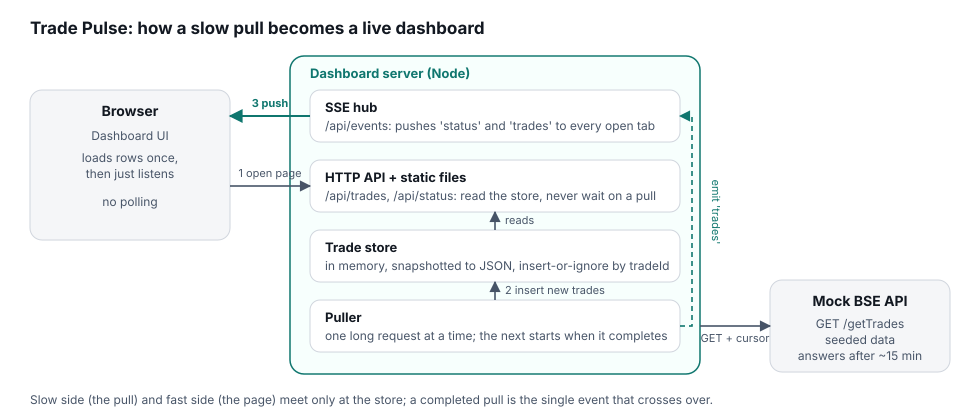
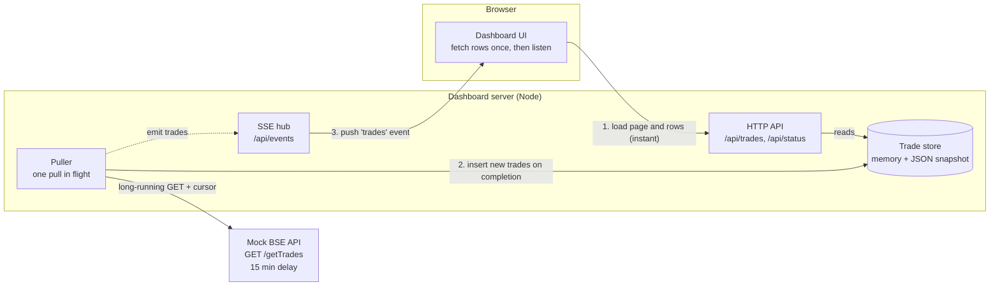

# Architecture note

## The problem

A pull from the exchange takes up to 15 minutes. The dashboard must never make a user wait for that, must show whatever has already been pulled the moment it opens, and must reflect a completed pull on screen without a refresh, without the browser polling, and without a cron job or scheduler.

## The design in one paragraph

The pull and the page are decoupled by a store. The dashboard server owns a background puller that makes one long request to the BSE API at a time. Page requests only ever read the store, so they return in milliseconds no matter what the puller is doing. When a pull completes, the puller inserts the new trades into the store and emits an event; the server forwards that event to every open browser over a Server-Sent Events (SSE) stream, and the browser prepends the rows. Each part has one job, and the only thing that crosses from the slow side to the fast side is a completed result.

## How each requirement is met

**Opens instantly, even mid-pull.** The HTTP handlers never touch the BSE API. `/api/trades` reads an in-memory store that is also snapshotted to a JSON file after every pull, so even a server restart comes up with data. The test measures this: the page and the first 50 rows load in well under 300 ms while a pull is in flight.

**New trades appear automatically, with no polling.** The browser opens one `EventSource` connection. The server writes to it only when something happens (a status change, or a completed pull that added trades). Nothing in the browser asks "is there anything new?" on a timer. The one `setInterval` in the page only redraws the elapsed-time clock locally and makes no network calls.

**No cron job or scheduler.** The puller is a single loop: start a pull, await its completion, start the next one. There is no schedule to drift or to double-fire, and there can never be two pulls overlapping. Completion of one pull is what triggers the next, so the system is naturally paced by the exchange. Timers appear in only two places, as safety rails rather than scheduling: an exponential backoff after a failed pull, and a one second minimum gap so a very fast API cannot be hammered.

## Why these choices

**SSE rather than WebSockets or polling.** Updates only flow one way, server to browser, which is exactly what SSE is for. It is plain HTTP, needs no library on either side, and the browser reconnects by itself if the connection drops. WebSockets would add a protocol and a library to solve a problem we do not have, and polling is explicitly ruled out.

**A store between the puller and the page.** If the page waited on the puller, it would be 15 minutes slow. If the puller pushed straight into the page, a user who opens the dashboard later would see nothing. The store makes the page's data independent of when it was opened. It also means a reconnecting browser can simply re-read the current state.

**Cursor-based incremental pulls.** The BSE API returns an opaque cursor with every response, and the puller sends it back on the next pull so only new trades travel over the wire. Inserts are also idempotent (keyed by trade ID), so a retried or overlapping pull cannot create duplicates. Correctness never depends on the cursor, it is purely an optimisation.

**`node:http` for the long request.** Node's built-in `fetch` aborts a request that has produced no response headers within five minutes, which would silently break a 15 minute pull. `node:http` has no such default, so the puller uses it directly and the mock server disables its own socket timeouts.

**Zero dependencies.** The whole system is built on Node's standard library, so setup is `npm run demo` with nothing to install and nothing to go out of date.

## Failure behaviour

If a pull fails or the connection drops, the status card shows the error, the puller backs off (1 s, 2 s, 4 s, up to 30 s) and tries again with the same cursor, and no data is lost or duplicated. If a browser loses its SSE connection it shows "Reconnecting…", the browser retries automatically, and on reconnect it re-reads the current page so it catches up on anything it missed. If the dashboard server restarts, it reloads the snapshot and the cursor from disk and resumes where it stopped.

## What I would change for production

The store is deliberately behind a small interface (`add`, `query`, `stats`, `save`), so it can be swapped for SQLite or Postgres without touching the rest of the app. With more than one dashboard instance, the puller should run on exactly one of them (a leader lock) or as its own worker, and the "new trades" event should travel through Redis pub/sub or Postgres `LISTEN/NOTIFY` so every instance can notify its own SSE clients. A very large trade history would move filtering and paging into SQL, and the SSE payload is already capped at the 200 newest trades per event, with the browser refetching if it needs more.
